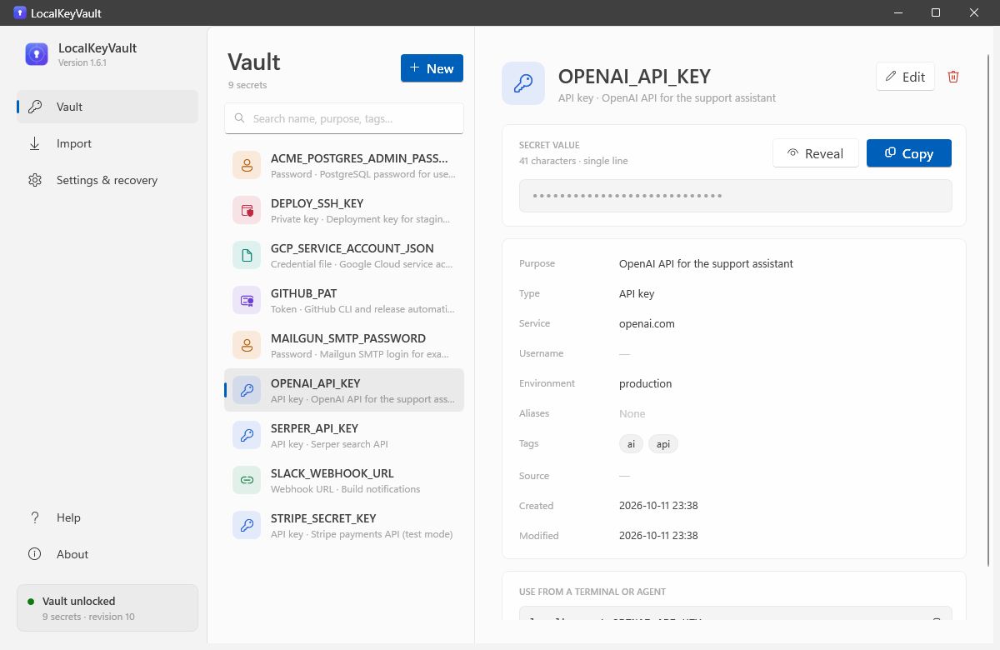
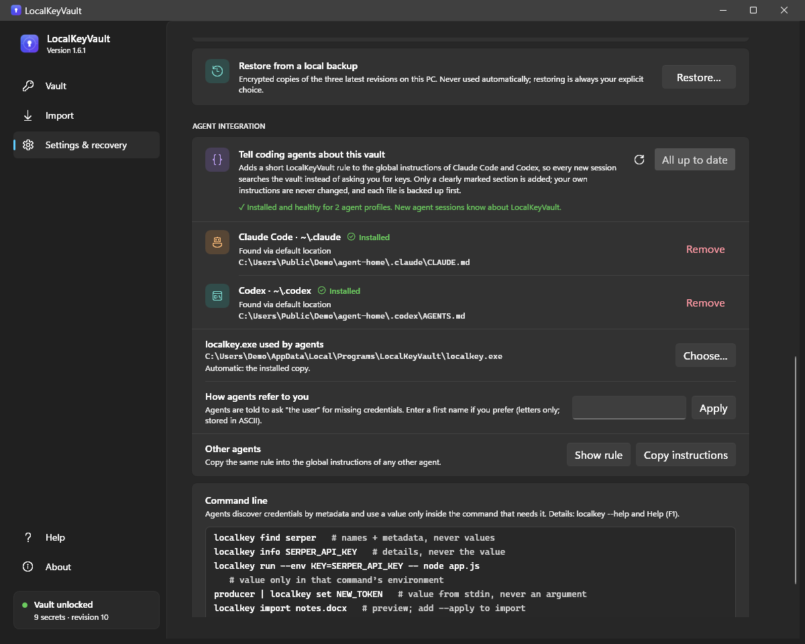
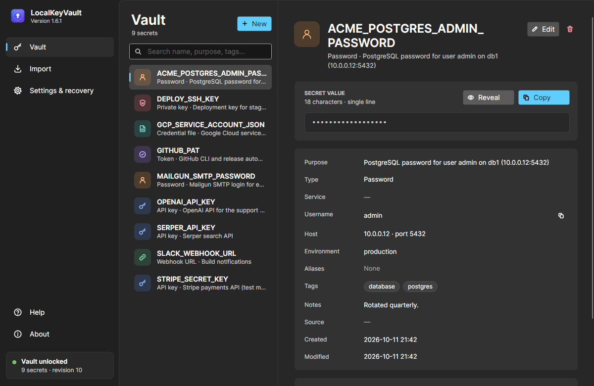

# LocalKeyVault

**A local, offline, encrypted vault for API keys, tokens and passwords, for Windows and Linux. Your coding agents can use these secrets without ever seeing them in prompts, files or logs.**

LocalKeyVault keeps your development credentials in **one encrypted file** on your own computer: API keys, tokens, passwords, connection strings and multi-line credentials such as JSON service accounts or PEM keys. Scripts, terminals and coding agents such as **Claude Code** and **Codex** find a credential by name, service, host or tag. They can then hand it to the one command that needs it, so the value never has to be pasted into an AI prompt, a `.env` file, source code or a chat window.

It works completely offline: no account, no cloud service, no telemetry and no update checks. The app contains no network code.

> **Download:** see [Releases](https://github.com/Maven303/LocalKeyVault-Releases/releases/latest). This repository publishes the applications only; the source code is not public.



---

## Contents

- [Features](#features)
- [Download](#download)
- [Install on Windows](#install-on-windows)
- [Install on Linux](#install-on-linux)
- [First steps](#first-steps)
- [Using it with Claude Code, Codex and other agents](#using-it-with-claude-code-codex-and-other-agents)
- [Command line](#command-line)
- [Where your data lives](#where-your-data-lives)
- [Recovery files: read this](#recovery-files-read-this)
- [Security model and limitations](#security-model-and-limitations)
- [Verifying downloads](#verifying-downloads)
- [Uninstalling](#uninstalling)
- [Help and support](#help-and-support)
- [Terms of use and privacy](#terms-of-use)
- [Hrvatski](#hrvatski)

---

## Features

- **One encrypted file (`vault.enc`)**, protected with AES-256-GCM. Names, values and descriptions are all inside the encryption. Any change to the file, damaged or deliberate, is detected and rejected.
- **The key stays on your computer.**
  - On Windows, the vault key is protected by your Windows account (DPAPI).
  - On Linux, it is a key file readable only by your user account.
  - The key is never written next to the vault or the program.
- **Desktop app** (Windows and Linux) to add, search, reveal, copy, edit, import and delete secrets.
  - System, light and dark themes.
  - **English and Croatian** interface, switchable at any time.
  - Built-in **offline help** (F1).
- **Rich, encrypted details per secret**: type, purpose, service, username, URL, host, port, environment, notes, source, aliases and tags. You and your agents find the right credential without opening values.
- **Import centre**:
  - **Sources**: Word documents (`.docx`), text, Markdown, CSV, JSON, YAML, INI/`.properties` and `.env` files. On Windows also the Credential Manager and environment variables.
  - **Whole files**: a credential file such as JSON or PEM can be stored as one secret.
  - **Safety**: every import is shown as a preview first, with values hidden.
- **Command line (`localkey`)**:
  - **Search without values**: `find` and `info` never print a value.
  - **`run`** gives a secret to a single command through its environment only.
  - **`get`** writes the exact value to standard output.
  - **`doctor`** diagnoses the setup.
- **Agent integration**: one click adds a short rule to Claude Code's and Codex's global instructions. New agent sessions then search the vault instead of asking you for keys. Your own instructions are never changed, and the rule can be removed again.
- **Clipboard safety**:
  - Copied secrets are marked so that Windows clipboard history and cloud clipboard skip them. On Linux they carry the password-manager hint.
  - The copy is cleared automatically after a delay you choose, if it is still on the clipboard.
- **Optional app lock**: a password for the window, with auto-lock after inactivity and when the screen locks or the computer sleeps.
- **Sync-friendly**:
  - Put `vault.enc` in a Google Drive, Dropbox, OneDrive, Nextcloud or Syncthing folder for backup. The cloud only ever sees encrypted data.
  - Saves are atomic, and conflict copies are reported.
  - Three encrypted local backups are kept.
- **Same vault on Windows and Linux**: a vault created on one system opens on the other with its recovery file.

<p>
  
  
</p>

---

## Download

All files are on the [latest release](https://github.com/Maven303/LocalKeyVault-Releases/releases/latest).

| System | File | Notes |
|---|---|---|
| Windows 11, 64-bit ¹ | `LocalKeyVault-Setup-1.6.1-win-x64.exe` | **Recommended.** Installs for your account only; no administrator rights. |
| Windows 11, 64-bit ¹ | `LocalKeyVault-Portable-1.6.1-win-x64.zip` | Portable: extract and run, nothing installed. |
| Debian, Ubuntu, Linux Mint, Pop!_OS | `localkeyvault_1.6.1_amd64.deb` | Installs to `/opt/localkeyvault`, commands in `/usr/bin`. |
| Fedora, RHEL, Rocky, AlmaLinux, openSUSE | `localkeyvault-1.6.1-1.x86_64.rpm` | Same layout as the .deb. |
| Any 64-bit x86 Linux with glibc 2.27+ | `LocalKeyVault-1.6.1-linux-x64.tar.gz` | Runs in place, or `./install.sh` installs for your account without root. |
| | `SHA256SUMS.txt` | Checksums of every download. |
| | `LocalKeyVault-Help-EN-*.html`, `LocalKeyVault-Pomoc-HR-*.html` | The user guides for Windows and Linux, in English and Croatian, readable offline. |

¹ Windows 10 version 1809 or later also runs it. However, .NET 10, which LocalKeyVault is built on, officially supports only the Enterprise, LTSC and IoT editions of Windows 10. On Windows 10 Home, Pro or Education, Setup tells you so and lets you decide.

Every build is **self-contained**: no .NET or other runtime needs to be installed. Linux builds need a graphical session for the window (X11, or Wayland through XWayland). The `localkey` command also works without one.

> **The installer, the packages and the programs are not digitally signed.** Windows SmartScreen may warn about an unknown publisher; see [Install on Windows](#install-on-windows). Check the downloads against `SHA256SUMS.txt` ([how](#verifying-downloads)).

---

## Install on Windows

**Installer (recommended)**

1. Run `LocalKeyVault-Setup-1.6.1-win-x64.exe`. The installer speaks English or Croatian, depending on your Windows display language.
2. If SmartScreen shows *Windows protected your PC*, the warning appears because the installer is not code-signed. Choose **More info → Run anyway**, but only if you downloaded the file from this page and its checksum matches.
3. It installs to `%LOCALAPPDATA%\Programs\LocalKeyVault`, adds a Start-menu entry (a desktop shortcut is optional) and adds that folder to your **user** PATH, so `localkey` works in every **new** terminal.

To upgrade, run the newer installer over the installed version. Your vault, key, settings and backups are never touched by setup.

**Portable edition**

Extract `LocalKeyVault-Portable-1.6.1-win-x64.zip` anywhere (also a USB drive) and start `LocalKeyVault.exe`.
- Nothing is installed, and PATH is not changed: call `localkey.exe` by its full path.
- The program files are portable, **the key is not**: the key, settings and backups live in `%LOCALAPPDATA%\LocalKeyVault` on each computer.

---

## Install on Linux

```bash
# Debian, Ubuntu, Linux Mint, Pop!_OS
sudo apt install ./localkeyvault_1.6.1_amd64.deb

# Fedora, RHEL, Rocky Linux, AlmaLinux
sudo dnf install ./localkeyvault-1.6.1-1.x86_64.rpm

# openSUSE
sudo zypper install ./localkeyvault-1.6.1-1.x86_64.rpm

# Any distribution, for your account only (no root)
tar -xzf LocalKeyVault-1.6.1-linux-x64.tar.gz
cd LocalKeyVault-1.6.1-linux-x64
./install.sh
```

- **Starting it**: start **LocalKeyVault** from the application menu, or run `localkeyvault`. The command line is `localkey`.
- **Where `install.sh` puts things**: the program goes to `~/.local/lib/localkeyvault` and the commands to `~/.local/bin`. Nothing outside your home folder is changed. `./uninstall.sh` removes it again.
- **Without installing**: the extracted folder also runs as is; start `./localkeyvault` in it.
- **Upgrading**: install the newer package over the old one. Your vault, key and settings are kept.
- **Disk encryption**: full-disk encryption (for example LUKS) is strongly recommended. See [Security model](#security-model-and-limitations).

Tested in fresh containers on Ubuntu 22.04, 24.04 and 26.04, Debian 12 and 13, Fedora 44, AlmaLinux 8 and 10, Rocky Linux 9, openSUSE Leap 15.6 and Tumbleweed, and Arch Linux (archive). The checks covered the command line, the window, the clipboard, the agent integration and uninstallation.

---

## First steps

1. **Create your vault.** On the first start, choose a folder for `vault.enc`. A synced cloud folder is fine and gives you an off-site encrypted backup. Then choose **Create vault**.
2. **Export a recovery file right away** when the app asks. Keep the file and its passphrase somewhere safe, away from the vault folder. Without it the vault cannot be opened after reinstalling the operating system or on another computer ([why](#recovery-files-read-this)).
3. **Add secrets** with **New**, or bring existing ones in on the **Import** page.
4. **Connect your agents**: open **Settings & recovery → Agent integration** and choose **Install for all**.
5. Try it in a **new** terminal:

   ```text
   localkey find stripe
   localkey info STRIPE_SECRET_KEY
   localkey run --env STRIPE_KEY=STRIPE_SECRET_KEY -- node app.js
   ```

---

## Using it with Claude Code, Codex and other agents

LocalKeyVault gives your agents a safe way to use credentials:

- **Discover**: `localkey find QUERY` searches names, service, username, host, URL and tags. `localkey info NAME` shows the details. Neither ever prints a value.
- **Use inside one command**: `localkey run --env VAR=NAME -- COMMAND ARGS...` starts the command with the secret in its environment only. The value never appears in the conversation, the command line or `localkey`'s own output.
- **Store new credentials**: `localkey set NAME` reads the value from standard input, never from an argument. If a brand-new secret must come from you, the agent asks you to add it in the app instead of pasting it into the chat.

**Agent integration** (Settings & recovery → Agent integration, or `localkey agents install`):
- **What it adds**: a short, clearly marked rule in each agent's global instruction file, which tells new agent sessions about the vault:
  - Claude Code: `~/.claude/CLAUDE.md`, or `CLAUDE_CONFIG_DIR`.
  - Codex: `AGENTS.md`, or `AGENTS.override.md`, in `~/.codex` or `CODEX_HOME`.
- **Your own instructions are never changed.** Every file is backed up before LocalKeyVault first modifies it. **Remove** restores the original bytes.
- **Fallback path**: the rule names the full path of `localkey`, so agents can still call it when PATH does not find it.
- **Other agents**: **Copy instructions** copies the same rule for any other agent.

The rule is guidance, not enforcement: an agent can still ignore it. See [limitations](#security-model-and-limitations).

---

## Command line

```text
localkey find QUERY [--json]             search names and details (never values)
localkey info NAME [--json]              one secret's details (never its value)
localkey list                            names, one per line
localkey get NAME                        the value on stdout, exact bytes
localkey run --env VAR=NAME [--env ...] -- COMMAND [ARGS...]
                                         run COMMAND with secrets in its environment only
localkey set NAME [--overwrite] [--trim-newline] [--type T] [--purpose P] [--service S]
                  [--username U] [--url URL] [--host H] [--port N] [--environment E]
                  [--notes TEXT] [--source S] [--tag T]... [--alias A]...
                                         value from stdin (a masked prompt in a terminal)
localkey delete NAME
localkey import FILE [--apply] ...       documents and config files: preview first
localkey import-env FILE [--apply] ...   .env files: preview first
localkey status                          vault path, revision, key state, count
localkey doctor [--json]                 read-only diagnostics of the whole setup
localkey agents status|install|update|remove|instructions
localkey --version | help
```

- **Arguments**: values are never accepted as arguments, because arguments are visible to other processes and to shell history.
- **Output**: messages go to stderr; stdout carries only data.
- **Exit codes**:
  - `0`: success
  - `2`: usage error
  - `3`: not found
  - `4`: vault busy
  - `5`: vault damaged or tampered with
  - `6`: key not available for this user (import your recovery file)
  - `7`: not set up yet
  - `8`: vault file unavailable
  - `9`: secret already exists

Run `localkey help` for the full reference, or see the Help pages.

---

## Where your data lives

| What | Windows | Linux |
|---|---|---|
| Encrypted vault | the file you chose, `vault.enc` | the file you chose, `vault.enc` |
| Vault key (never synced) | `%LOCALAPPDATA%\LocalKeyVault\keys`, protected by DPAPI | `~/.local/share/LocalKeyVault/keys`, owner-only (0600) |
| Settings, app lock, local encrypted backups | `%LOCALAPPDATA%\LocalKeyVault` | `~/.local/share/LocalKeyVault` |
| Recovery file | wherever you save it | wherever you save it |

LocalKeyVault never writes plaintext secrets, logs or temporary plaintext files. While saving, a short-lived **encrypted** temporary file is renamed over the vault atomically.

---

## Recovery files: read this

The key that opens your vault belongs to your user account on this computer. After reinstalling the operating system, on a new computer or under another user account, **only a recovery file can open the vault.**

- **Export**: go to **Settings & recovery → Export a recovery file**. Choose a passphrase of at least 12 characters (four or more random words are recommended) and a location **outside** the vault folder. Each export is re-read and tested immediately.
- **Keep both safe**: keep the file and its passphrase safe and separate. Together they give full access to every secret in the vault.
- **Import**: when the app reports that the key is missing, choose **Import recovery file…**. Nothing is saved until the recovered key actually opens your vault.
- **Moving between systems**: the same recovery file also moves a vault from Windows to Linux, or the other way round.

---

## Security model and limitations

**What it protects against**: someone who obtains `vault.enc` learns nothing about names or values. That covers a cloud account compromise, a sharing mistake, a stolen backup and old versions in the cloud's trash.
- Any modification, truncation or splicing of the file is detected and rejected.
- A crash during a save leaves either the old or the new complete file.
- The app and the command line can be used at the same time without corrupting the vault.

**Cryptography**:
- **Vault encryption**: for every save, a fresh random salt and nonce; HKDF-SHA256 key derivation; AES-256-GCM with an authenticated header.
- **Recovery files**: PBKDF2-HMAC-SHA512 with 600,000 iterations, plus AES-256-GCM.

**Limitations, by design:**

- **Same-user access**: any program running under your user account can read your secrets, for example by running `localkey get`. LocalKeyVault keeps secrets out of projects, prompts and files; it is not a sandbox against malware running as you.
- **App lock**: it protects the window only. The `localkey` command and your agents keep working without it.
- **Agent rule**: it is guidance, not enforcement. `localkey run` keeps values out of command lines and out of LocalKeyVault's output, not out of the program you start.
- **Memory**: values that were shown or copied may stay in memory until the program exits.
- **Clipboard managers**: protection depends on them honouring the "do not record" markers.
- **Linux key protection**: on Linux the key is protected by file permissions, not by an operating-system key store. Use full-disk encryption.
- **Unsigned files**: the installer, the packages and the programs are not code-signed.

---

## Verifying downloads

Compare the SHA-256 checksum of each download with `SHA256SUMS.txt`:

```powershell
# Windows (PowerShell)
Get-FileHash .\LocalKeyVault-Setup-1.6.1-win-x64.exe
```

```bash
# Linux, in the download folder
sha256sum -c SHA256SUMS.txt --ignore-missing
```

---

## Uninstalling

- **Windows**:
  - **Installed edition**: *Settings → Apps → Installed apps → LocalKeyVault → Uninstall*.
  - **Portable edition**: delete its folder.
- **Linux**:
  - **Packages**: `sudo apt remove localkeyvault` or `sudo dnf remove localkeyvault` (on openSUSE, `sudo zypper remove localkeyvault`).
  - **Archive install**: run `~/.local/lib/localkeyvault/uninstall.sh`.
- **Your data is kept** after uninstalling: the vault, the key and the settings stay where they are. Delete them yourself only when you are sure you no longer need them. Without the key or a recovery file, the vault cannot be opened.

---

## Help and support

- **Built-in help**: the full user guide is in the app (**Help**, or F1) and works offline. The same guides are attached to each release as HTML files.
- **Diagnostics**: `localkey doctor` checks the whole setup and explains what to fix.
- **Problems and suggestions**: open an [issue](https://github.com/Maven303/LocalKeyVault-Releases/issues). **Never post secrets, vault files, key files or recovery files.**

---

## Terms of use

LocalKeyVault is **free to download and use**. It is provided **"as is", without warranty of any kind**. Nothing replaces your own security habits: keep your recovery file and passphrase safe and separate. See [LICENSE.txt](LICENSE.txt) for the full terms and [THIRD-PARTY-NOTICES.md](THIRD-PARTY-NOTICES.md) for the open-source components the apps include.

**Privacy:** LocalKeyVault collects, transmits and shares no data at all; see the [privacy policy](PRIVACY.md).

© 2026 Tomislav Savić. All rights reserved.

---

## Hrvatski

**LocalKeyVault** je lokalni, šifrirani trezor za API ključeve, tokene i lozinke, za Windows i Linux.

- **Jedna šifrirana datoteka**: sve tajne čuva u jednoj šifriranoj datoteci na vašem računalu.
- **Za agente**: agenti za programiranje kao što su Claude Code i Codex mogu ih pronaći i upotrijebiti, a da se vrijednosti nikad ne pojave u upitima, datotekama ili zapisima.
- **Bez interneta**: radi potpuno bez interneta, bez računa, oblaka i telemetrije.
- **Na hrvatskom**: sučelje i ugrađena pomoć su i na hrvatskom jeziku.

**Preuzimanje i instalacija**: sve datoteke su na stranici [Releases](https://github.com/Maven303/LocalKeyVault-Releases/releases/latest).
- **Windows**: pokrenite `LocalKeyVault-Setup-1.6.1-win-x64.exe`. Instalira se samo za vaš račun i ne trebaju administratorska prava. Prijenosno izdanje je ZIP.
- **Linux**: `.deb` (Debian, Ubuntu), `.rpm` (Fedora, RHEL, openSUSE) ili `.tar.gz` za bilo koju distribuciju (`./install.sh`).

**Prvi koraci**:
1. Odaberite mapu za trezor.
2. **Odmah izvezite datoteku za oporavak** i čuvajte je na sigurnom, zajedno s pristupnom frazom. Bez nje se trezor ne može otvoriti nakon ponovne instalacije sustava ili na drugom računalu.
3. Dodajte ili uvezite tajne.
4. Za agente odaberite **Postavke i oporavak → Integracija s agentima → Instaliraj za sve**.

**Napomene**:
- Instalacijski program i paketi **nisu digitalno potpisani**: Windows SmartScreen može upozoriti na nepoznatog izdavača (*More info → Run anyway*). Provjerite kontrolni zbroj u datoteci `SHA256SUMS.txt`.
- Alat je **besplatan** i daje se **kakav jest, bez ikakvog jamstva**.

© 2026 Tomislav Savić. Sva prava pridržana.
